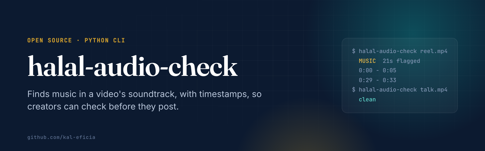
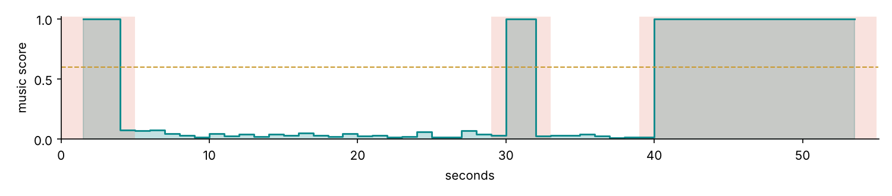

<p align="center"></p>

<p align="center">
  
  
  
  
</p>

Many Muslim creators keep their videos free of music. Then a template adds a beat under the intro, a stock clip carries a melody, an editor drops in a riser, and nobody notices until the comments do.

**halal-audio-check** listens to the whole soundtrack and tells you exactly where music is, so you can check it before you post. It runs on your own machine, with no upload and no account.

```text
$ halal-audio-check final-reel.mp4
final-reel.mp4  MUSIC  21s flagged in 0:55
  0:00 - 0:05  score 1.00
  0:29 - 0:33  score 1.00
  0:39 - 0:55  score 1.00

$ halal-audio-check voiceover-only.mp4
voiceover-only.mp4  clean  no music found in 0:20
```

<p align="center"></p>
<p align="center"><sub>A 55-second test edit: a music intro, a voiceover, sound effects, a 2-second melodic sting, then talking over a quiet music bed. The voice and sound effects stay low. Every piece of music is flagged.</sub></p>

## What it listens for

Music has two things that speech and ordinary sound effects rarely have:

- **Held pitches.** Notes and chords stay on the same pitch for half a second or more. A voice glides and stops. The checker tracks spectral peaks and asks whether they're still there, at the same pitch, at every checkpoint across half a second.
- **A beat.** A regular pulse between 60 and 180 BPM in the onset envelope, with a second pulse at double the lag to confirm it.

It also listens in the **gaps between words**. A voice pauses; a music bed doesn't. Steady narrow peaks in the quietest quarter of each window give away a bed sitting under a voiceover, even when the voice is much louder.

Each 3-second window gets a score from 0 to 1, overlapping by 2 seconds, and anything over the threshold is merged into flagged stretches with timestamps.

## What's tested

The test suite generates its own audio: voices with natural intonation, music with and without a beat, drums alone, whooshes, clicks and impacts, and voices over music beds. In the tests:

- **0 false flags** across 25 voices, 15 sound-effect tracks and 7 voice-plus-effects mixes
- music, a melody without a beat, and drums alone are all flagged
- a music bed 16 dB under a voice is flagged across more than 90% of its length
- a 2-second sting in the middle of speech is found and placed correctly

It's a screening tool. It tells you where to listen. Your ears make the call, and very quiet beds (more than about 22 dB under a constant voice) can slip through. Vocal-only nasheeds with held notes will also be flagged, which some creators want and some don't.

## Use it

```bash
pip install git+https://github.com/kal-eficia/halal-audio-check   # needs ffmpeg for video files

halal-audio-check video.mp4                    # exit code 1 if music is found
halal-audio-check *.mp4 --json                 # for pipelines
halal-audio-check reel.mov --timeline reel.png # score timeline (needs matplotlib)
halal-audio-check video.mp4 --threshold 0.5    # stricter
```

The exit code makes it a gate: put it at the end of an export script and a video with music never leaves the folder.

```python
from halalaudio import check_file
report = check_file("final.mp4")
report.clean, report.music_seconds, [(s.start, s.end) for s in report.segments]
```

## Tests

```bash
python -m unittest discover -s tests
```

## Related

- [claude-video-studio](https://github.com/kal-eficia/claude-video-studio): the Claude Code editing studio this was built for, with a halal-sound-only rule

---

Built by [Kalid Nur](https://github.com/kal-eficia). MIT licence.
